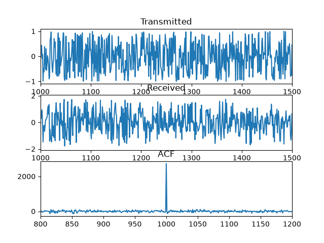

# Experiment notes

I'm trying to make a radar example where I send a signal, receive a signal, and try to interpret the distance to the object.

My first iteration used a sinusoid signal, which sees delay peaks in the ACF every period. The envelope is triangular as I include less and less of the received single as the lag increases.

Why didn't I observe a peak equal to the distance to my object? I need a signal with better ACF properties.

Because of this, I'm adding a second xf() function that is more random, and not correlate with each period.

