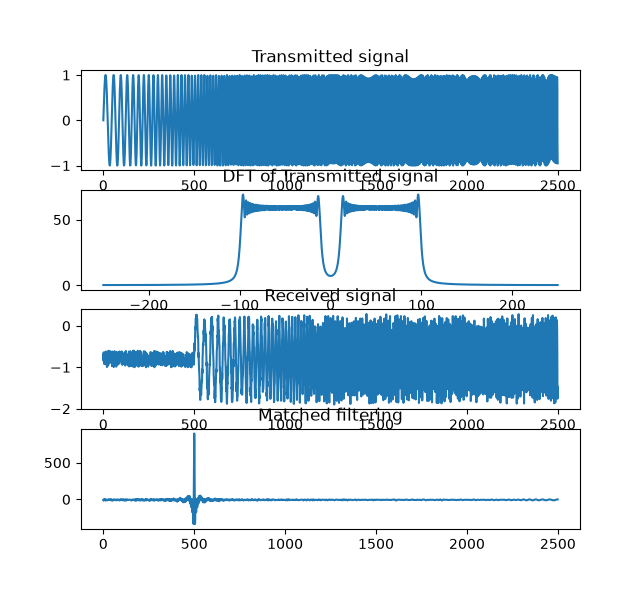

# Radar Pulse Compression

A long radar pulse provides more transmitted energy, but a simple unmodulated long pulse gives poor range resolution. A short pulse provides better range resolution, but at the same peak power it transmits less energy.

Instead of transmitting a constant frequency pulse, we transmit a chirp, a signal whose frequency changes over time.

When we correlate the received chirp with the transmitted chirp, we obtain a narrow correlation peak.

**Learning Goal:** A long transmitted pulse can produce a narrow peak after matched filtering, allowing accurate delay estimation and fine range resolution.

**Development steps**

* Generate the chirp signal
* Analyze the FFT and examine frequency contents
* Simulate the received signal containing delayed copies of the transmitted signal along with added noise
* Implement matched filtering
* Convolve received signal with the matched filter and investigate peaks corresponding to the target delays
* Investigate various chirps with different bandwidths and the resulting range resolution

# Generating a chirp signal

Start with a sinusoid

$$
x(t) = A \cdot sin(2\pi f_0 t)
$$

Describe the instantaneous frequency as:

$$
f(t) = f+kt
$$

Where k is the chirp rate. It can be calculated using:

$$
k = \frac{f_1 - f_0}{T}
$$

It might be intuitive to insert the $f(t)$ expression into $x(t)$. Recall that the expression inside the sine function shows how many revolutions we currently have, expressed as $2\pi f t$. The previous $f(t)$ expression shows how $f$ changes over time. We need to integrate this to extract how many revolutions we have so far.

$$
\phi(t) = \frac{1}{2\pi}\int_{0}^{t}f(\tau)d\tau \\
\phi(t) = 2\pi (f_0 t+\frac{k}{2}t^2) \\
\rightarrow x(t) = Asin(2\pi(f_0 t + \frac{k}{2}t^2))
$$

For a sampling frequency $f_s$ and $n$ samples:

$$
t_n=\frac{n}{f_s} \\
\rightarrow x(t) = Asin(2\pi(f_0 \frac{n}{f_s} + \frac{k}{2}(\frac{n}{f_s})^2))
$$

My own interpretation: If $f$ was alone, it would work by simply inserting $f$ into $x(t)$, but because its time-dependent, we need to extract the current phase from the $f(t)$ function. Pay attention to the $t$ inside $f(t)$!

